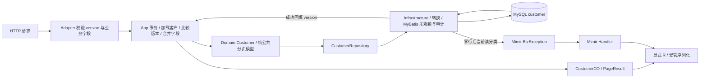

# 客户数据一致性设计

**归属版本**：1.3.0。输入：[需求约定](spec.md)、[公共 API 契约](../../../design-docs/arch-api-contract.md)、[版本记录](../release.md)。实施基线为本地 develop 的 `56a8716`。

## 背景、目标与边界

当前 App 先读客户再更新完整实体，Infrastructure 忽略 updateById 影响行数，DO/V1 无版本列。列表中的 selectPage 默认已查询总数，App 又调用 Repository.count。现有 createdAt/updatedAt 也不符合 Mimir 默认审计字段名。

目标是落实 B1–B4：更新恰好影响 1 行才成功；0 行按当前记录是否存在区分 20001/21002；V1 原始数据及时间值保留；使用同一次分页调用的记录和总数。范围覆盖 Adapter、App、Domain、Infrastructure、Start，采用完整设计。

不引入认证、数据库外重试或新异常处理器；不修改删除并发语义、HTTP 信封、其他项目、发布配置或依赖版本。迁移采用停写窗口，不提供新旧二进制同时写入的滚动兼容。

## 已核对的框架依据

以相邻 Mimir 仓库的 **git tag v2.4.0** 源码核对，不依据其未提交改动：

- `mimir-boot-common/.../page/PageResult.java`：`PageResult<T extends Serializable>`，`map(Function<? super T, ? extends U>)` 保留分页元数据。
- `mimir-boot-starters/mimir-boot-starter-mybatis/.../page/PageConverters.java`：`toMybatisPage(PageRequest)` 返回 Page；`toPageResult(IPage<T>)` 的 T 也要求 Serializable。
- 同模块 `audit/AuditorProvider.java`：`String currentAuditor()`；`AuditMetaObjectHandler` 填充 createBy/createTime/updateBy/updateTime，时间类型为 LocalDateTime，主体为 String；采用严格填充。
- `config/MybatisPlusAuditConfiguration.java` 默认提供审计主体 system 与 Handler，均允许自定义 Bean 退让；`MybatisPlusAutoConfiguration` 默认拦截器包含乐观锁。

这些证据证明 API 和默认配置存在，不证明本项目实际自动装配或 SQL 行为。实施时检查有效依赖版本、是否有自定义拦截器/Handler 覆盖，运行验收再核实真实生效情况。

## 架构与数据流

Domain 仅使用 Java 与 mimir-boot-common，不能引入 MyBatis、Spring 或审计注解。Customer 为满足 PageResult 泛型新增 Serializable/serialVersionUID；审计字段留在 DO，不加入公共 CustomerCO。

## 接口契约

### HTTP 与用例（B1、B2）

| 接口 | 输入/输出变化 | 错误与幂等性 |
| --- | --- | --- |
| POST `/api/customers`；`CustomerCO create(CreateCustomerCmd cmd)` | 输入不变；CustomerCO 增加 `version:integer`，成功为 0 | 21001 等既有错误不变；不承诺幂等 |
| GET `/api/customers/{id}`；`CustomerCO getById(Long id)` | CustomerCO 增加 version | 不存在 20001；只读 |
| PUT `/api/customers/{id}`；`CustomerCO update(UpdateCustomerCmd cmd)` | 请求/Cmd 增加必填 Integer version；输出为递增后 version | 20001/21001/21002；同一版本成功一次后重放为 21002，不自动重试 |
| GET `/api/customers`；`PageResult<CustomerCO> list(ListCustomerQry qry)` | 每个 CustomerCO 增加 version，其余参数及分页结构不变 | 查询失败走安全系统错误；只读 |
| DELETE `/api/customers/{id}`；`void delete(Long id)` | 无变化，不要求 version | 维持既有 20001 和 data=null，不扩展本项并发保证 |

HTTP 成功为 200+00000；BizException 为 200+业务码；MVC 字段/绑定错误为 400，细节沿用既有 Handler。对外 version 采用 Integer/INT，最大值仍在 JS 安全整数范围内；不改变数字 ID 策略。

UpdateCustomerRequest/Cmd 对 version 加 NotNull、Min(0)、Max(2147483646)。App 显式执行同样防线，不假设直接调用触发注解。类级空更新校验继续只看 name/email/phone，version 本身不算修改。

HTTP version 只接受 JSON 整数 token，不接受小数、布尔值或数字字符串，避免 Jackson 将 3.5 截断成 3。采用仅标注在 UpdateCustomerRequest.version 上的 `CustomerVersionDeserializer`，null 保留给 NotNull、越过 Integer 类型范围按请求体错误处理；不修改全局 ObjectMapper 或其他字段。0..2147483646 的业务范围仍由字段校验负责。

HTTP 先执行既有 MVC 绑定与字段校验；进入 App 后的错误判定顺序：输入版本及空更新防线 → 加载客户（无则 20001）→ 比较读到的版本（不匹配则 21002）→ 合并字段、邮箱预查、领域校验 → 条件写入。预查后真正写入的邮箱唯一键异常仍定向映射 21001；未知数据库错误不强行改成版本冲突。

### 仓储（B1、B2、B4）

- 保留 `Customer save(Customer customer)`、`Optional<Customer> findById(Long id)`、`Customer update(Customer customer)`、`void deleteById(Long id)`、`boolean existsByEmail(String email)`。
- 用 `PageResult<Customer> findPage(PageRequest page, String keyword, String status)` 替换 `findAll(int,int,String,String)` 与 `count(String,String)`，同步所有当前调用方/测试；不保留内部双查询兼容入口。
- save 初始化/持久化 version=0，写入成功才回填 ID/版本；insert 非 1 行为系统错误，不回包假成功。
- update 的 Customer.version 是预期版本。Repository 也显式拒绝 null/负数/超过 2147483646 的版本并抛 PARAM_INVALID，不能仅依赖 App 或 @Version，防止拦截器因 null 版本跳过乐观锁。DO 显式 `@Version Integer version`；每次构造新的 DO，经默认乐观锁条件更新，不能通过普通 updateById 绕开 version，也不在失败后复用已被拦截器递增的 DO 重试。
- 影响行数=1：仅此时将 DO 的递增后 version 回填到返回 Customer。影响行数=0：执行下文当前读分类，不回填本地被预增的值。其他行数为系统异常，事务回滚。

### 零行更新的当前读（B2）

MySQL 默认 REPEATABLE READ 下，普通 selectById 可能仍看到首次读取的旧快照，不能据此区分“读后被删”和冲突。零行后在**同一个 App 更新事务、同一连接**调用生成 Mapper 的通用 selectOne，条件固定为 ID，SQL 尾部固定 `FOR UPDATE`；无行为 DATA_NOT_FOUND，有行为 VERSION_CONFLICT。不把用户输入拼成 SQL，不改生成的 Mapper，不升级隔离级别、不使用 REQUIRES_NEW。

该查询必须真正访问数据库：核对 MyBatis 更新语句 flushCache、锁查询不同 SQL 的缓存键，以及未启用自定义二级缓存；若实际配置导致缓存命中，须在本仓储调用范围解决，不能忽略验证或全局放宽配置。运行验收记录锁查询 SQL 与同连接证据。若实际 Mapper/插件无法满足该路径，先报告具体证据并修订方案，禁止退回普通快照查询。

错误代表失败写入后的当前读所见状态，不承诺分类完成后记录永远存在；请求不会自动重新加载最新版本后覆盖。行锁等待、死锁、连接故障不冒充 21002，交给既有安全系统错误处理，事务回滚。

### 分页转换（B4）

App 将 qry.toPageRequest() 的纠正值传入 findPage，保留当前页码 int 上限的 HTTP/直调保护。Infrastructure 用 PageConverters.toMybatisPage 创建分页对象，保留关键字 OR 分组、状态 AND 和 ID 降序，调用一次 selectPage；将其 records 从 DO 转为 Customer 后，经 PageConverters.toPageResult 输出。App 用 PageResult.map(ASSEMBLER::toClientObject)，不重算元数据、不再调用 count。

“单次”指 **一次 selectPage 调用**；分页插件通常仍执行 count SQL + records SQL，零结果/越界页可能省略 records SQL。本项消除额外的 Repository.count，不承诺单条 SQL，也不承诺两条 SQL 在并发写入下构成同一快照。保持默认 overflow=false，不把越界页重置为第 1 页。

## 数据模型与迁移（B1、B3）

唯一迁移源仍为 Start 的 `db/migration`。新增 `V2__customer_audit_and_version.sql`，V1 文件名和内容均不改。

| 列 | 类型/约束 | 迁移与填充 |
| --- | --- | --- |
| created_at → create_time | DATETIME NOT NULL，保留 CURRENT_TIMESTAMP 默认 | 改名保留原值；DO LocalDateTime createTime，INSERT 填充、更新策略 NEVER |
| updated_at → update_time | DATETIME NOT NULL，保留 DEFAULT/ON UPDATE CURRENT_TIMESTAMP | 改名保留原值；DO LocalDateTime updateTime，INSERT_UPDATE 填充 |
| create_by | VARCHAR(64) NOT NULL DEFAULT 'system' | 历史值补 system；DO String createBy，INSERT 填充、更新策略 NEVER |
| update_by | VARCHAR(64) NOT NULL DEFAULT 'system' | 历史值补 system；DO String updateBy，INSERT_UPDATE 填充 |
| version | INT NOT NULL DEFAULT 0 | 历史值补 0；DO `@Version Integer`；Domain/CO Integer，创建初始化 0 |

ID、自增、50/100/20 业务列、状态、idx_email、idx_status、字符集与排序规则保持原样。采用一条 ALTER TABLE 包含列改名和新增列，利用目标 MySQL 8.4 的单条 DDL 原子性；不把它描述成 Flyway 多语句事务回滚。按目标数据量预演锁表/耗时，不预设在线无锁。

InfraConvertor 双向映射 version，审计字段不进入 Domain。insert/update 都用新构造的 DO，审计待填字段保持 null，避免 strictUpdateFill 因已有值而跳过刷新；创建信息通过更新策略禁止覆盖。审计属性显式 TableField 映射，避免依赖不明的全局命名策略。不引入不存在的 MybatisBaseDO。

在 Infrastructure 的独立配置 `CustomerAuditConfiguration` 中声明 AuditorProvider 示例 Bean，返回 system，注释说明接入认证时替换此处；不复制 Mimir Handler、不新增认证依赖。默认主体长度 6，在 64 上限内。将来接入身份源需遵守列长度约束，不能静默截断。

迁移需停写并停止旧实例：备份与核对 V1 状态 → 在副本预演 → 正式停写执行迁移 → Flyway validate 与数据/索引比对 → 仅启动新版并验收 → 恢复流量。迁移前核对须将实际列类型、长度、null/default、时间自动更新属性、主键/自增、唯一键与普通索引、引擎及字符集/排序规则逐项与 V1 预期 DDL 比较，任何结构偏差都停止迁移；不能仅检查 Flyway history 或保存迁移前的结构。Flyway validate 校验迁移记录及脚本，不能代替实际结构比对。新库必须顺序执行 V1+V2。失败时保留快照与日志，检查实际结构及 Flyway 历史；不自动 clean/repair、删表或改 V1 校验和。回退以备份恢复及匹配旧二进制为单位，不能仅回退应用后继续写新列结构；实际恢复须单独获得目标环境操作授权。

## 非功能约束与取舍

| 维度 | 本项标准 |
| --- | --- |
| 并发正确性 | 同一旧版本最多 1 次更新成功；失败不改业务/审计字段，不做自动重试 |
| 查询开销 | 一次列表最多调用一次 selectPage，无额外 Repository.count；不设未经测量的时延/SLA |
| 数值边界 | version 输入 0..2147483646、输出 0..2147483647；分页保持既有边界和 Long 总数 |
| 安全 | 0 个客户端可写审计字段；错误不回显 SQL/凭据；固定锁查询不接收 SQL 片段 |
| 质量 | 保持四业务模块指令 60%/分支 50% 门槛及生产/测试 PMD/CPD 零违规，不新增外部 I/O 测试 |

| 备选 | 不采用原因 |
| --- | --- |
| 只检查影响行数，不加 version | 可识别删除，仍会静默覆盖其他编辑者 |
| App 全程 select for update | 加锁更早，且不能代替客户端旧版本识别；选择成功路径乐观锁，仅失败分类做当前读 |
| 自写 count 与分页结果包装 | 重复框架转换及总数查询，扩大维护面 |
| 修改 V1 或保留审计列旧名 | 前者破坏既有迁移校验；后者继续维护与默认审计字段的差异 |

## 验证策略与阶段

| 行为/接口 | 本地隔离证据 | 运行环境证据 |
| --- | --- | --- |
| B1 create/get/list | App、转换器、standalone、受管序列化断言 version=0/实际值 | 新库与旧库升级后的实际 CRUD/JSON |
| B2 update | 版本边界、空更新、比较顺序、1/0/异常行数、成功回填与失败不回填、邮箱翻译回归 | MySQL 两连接受控交错及真实 HTTP 旧版本更新；证明 SQL 含版本条件 |
| B3 audit/migration | 真实审计 Handler 对 DO 元数据的纯单元验证、配置 Bean 直接调用，不启动上下文 | V1→V2、新库 V1+V2、validate、历史值/索引保留、创建信息不变、失败后审计不变 |
| B4 findPage/list | 单次 Mapper 分页、无额外 count、过滤/排序、Long 总数、空/越界页元数据 | 检查 SQL，无第二份独立 count；不把 mock 当作数据库查询证据 |

阶段按模型与迁移 → 条件更新/分页仓储 → App/HTTP 契约 → 完整本地门禁 → 获准环境的人工运行验收推进。后两者分别记录；人工验收未做时可交付源码与本地测试，但 TD-005/TD-012 保持待验收，不能写成完成。完整的任务和人工步骤见计划。
