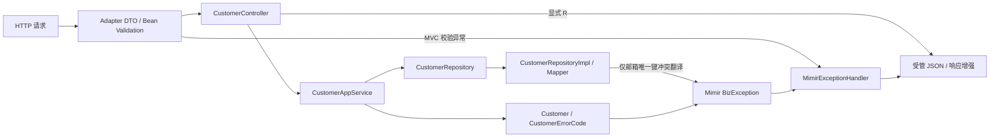

# 客户 R 契约统一设计

**归属版本**：1.3.0

## 背景与目标

当前 Controller 返回 COLA 信封，本地 Advice 返回 ErrorResponse，Mimir Advice 返回 R；业务异常仍为 COLA 类型。目标是落实[需求约定](spec.md)的六组行为，并使所有五个接口显式返回统一信封。跨项目字段、状态与分期语义统一维护在[API 契约](../../../design-docs/arch-api-contract.md)，本文仅说明实现选择。

核对依据为 Mimir 正式 `v2.4.0` 源码：Common 的 `R`、`BizException`、`PageRequest/PageResult`，Exception 的 `MimirExceptionHandler`、`ValidationErrorExtractor`，Web 的 `JacksonConfig`、`RSuccessMixin` 与 `ResponseBodyEnhancer`。本地实施基线为 `292d378`，不根据上游默认工作树推断正式 API。

## 范围与取舍

- 采用已确定的 HTTP 200 + 业务码方案，不重开 COLA/R 选型；移除本地 Advice 和 ErrorResponse，不新增响应工厂或全局包装器。
- 本项不修改表结构、version、影响行数语义、审计字段、单次分页查询、CORS 或日志配置；不清理所有 COLA 组件依赖，不修改 Asgard/Bifrost，不引入认证或集成测试。
- 正式 JSON 会输出 `success`，默认忽略 `fail`。为实现既定的显式 `data:null`，使用原生 `mimir.boot.web.serialization.write-nulls=true`；它也使业务 DTO 的空字段显式输出 null。保留 `include-legacy-fail=false` 和数字 ID 默认值，不加自定义 MixIn 隐藏 success。
- 保留空电话的现有语义：null 表示缺省/不更新，字符串 "" 可用于清空。只补长度，不引入新的电话号码规则。

## 架构与数据流

Domain 只新增纯 POJO 的 `mimir-boot-common` 依赖，不依赖 Spring、MyBatis 或 Adapter。数据库异常的识别留在 Infrastructure，向上抛领域错误；App 不解析 SQL/索引名。现有主外键、迁移与 Repository 接口不改变。

## 接口与数据模型

完整 HTTP 参数、字段类型、错误码、删除及重复操作语义见 API 契约；对应 Spec 的五个客户接口与公共错误行为。

| Java 接口变化 | 输入与返回 | 说明 |
| --- | --- | --- |
| Controller create | `create(CreateCustomerRequest request): R<CustomerCO>` | 去除创建 201 |
| Controller getById | `getById(Long id): R<CustomerCO>` | 不存在交 Mimir Handler 返回 20001 |
| Controller update | `update(Long id, UpdateCustomerRequest request): R<CustomerCO>` | 路径 ID 写入 Cmd，保留部分更新含义 |
| Controller delete | `delete(Long id): R<?>` | 去除 204；使用 `R.success()`，显式 null 数据；Void 不满足 Serializable 泛型上界 |
| Controller list | `list(ListCustomerQry qry): R<PageResult<CustomerCO>>` | 不再将 totalCount 截断为 int |
| App list | `PageResult<CustomerCO> list(ListCustomerQry qry)` | 替换原 List 返回及公开 count；Controller 只取一个分页结果 |
| Qry 转换 | `PageRequest toPageRequest()` | 原始字段为 Long；调用 `PageRequest.of`；仅返回纠正后的请求对象 |
| Domain 错误 | `CustomerErrorCode implements ErrorDefinition` | `21001` 邮箱重复、`21002` 版本冲突；`20001` 复用 ErrorCode |

`CustomerCO`、两个 Web 请求 DTO、两个 Cmd 与 Qry 实现 Serializable，声明 serialVersionUID；字段仍是 Long/String 与现有客户字段，不增加 version。不搬入 Client，不改变领域 Customer 的存储表示。

### 输入校验与 HTTP 状态

- Web DTO 使用字段约束：姓名 2–50；创建姓名/邮箱必填；创建和更新邮箱保留现有 `@Email`，同时补足当前 Domain 的格式、非空白及 100 长度限制，更新时 null 合法；电话 `@Size(max=20)`，null 与 "" 合法。保证 HTTP 校验通过的邮箱满足 Domain 防线，不反向放宽原 HTTP 格式校验；Domain 直调保留现有正则规则。不能仅依赖 `@Email` 接受 Domain 会拒绝的值，例如无点号域名。
- 创建/更新 Cmd 补齐相应字段长度约束，保留必要声明；App 与 Domain 仍以显式校验防御直接调用，不能假设 Cmd 注解自动触发。
- 更新 DTO 新增类级 `@ValidCustomerUpdate` 及 Validator，只检查三个可更新字段不全为 null；校验失败保留对象级错误，使 Mimir 输出 `OBJECT/$`，不伪造一个业务字段。
- Domain/App 直接调用的无效输入抛 `BizException.fromError(ErrorCode.PARAM_INVALID)`，缺失客户为 DATA_NOT_FOUND，邮箱占用为 CustomerErrorCode。Mimir BizException 一律 HTTP 200；HTTP 400 由 MVC 校验/绑定失败产生，不在本地新建 Advice 强改状态。
- Domain 校验发生在任何 Mapper 写入前；更新仍先在 App 做空更新防线。非法输入单元测试断言不执行仓储写入；本项不扩展“并发失败后对象回滚”等行为。

### 分页衔接

- Qry 用 Long `pageIndex/pageSize` 替代 int `page/size`，保留 keyword/status。不兼容旧参数别名；无参数使用 1/10，null/小于 1 由 PageRequest 纠正，大小超过 1000 截到 1000，移除旧大小 100 上限。
- `pageIndex` 使用 `@Max(2147483647)` 约束，HTTP 越界返回 400；App 直接调用也对纠正后页码超界抛 PARAM_INVALID，不允许算术溢出变成未知 500。非数字绑定遵循 Mimir 的 400 映射。
- App list 只规范化一次，将同一 PageRequest 的页码/大小安全转换给现有 int Repository，再以 `PageResult.of(records,total,pageIndex,pageSize)` 组装结果。原内部 `findAll + count` 保留，删除公开 App count 方法，更新其调用方与测试；单次 selectPage 与 PageConverters 留给下一项。
- 保留总数 Long、空列表 []、过滤和降序；不接收新的排序字段。旧参数 `page/size` 不再绑定分页字段，按 Spring 对未知参数的现有行为忽略，不能把它们当兼容输入并暗中转换。

### 外部失败与异常翻译

- 应用预查邮箱只能提供友好失败，不能代替唯一键保障。Infrastructure 的 save/update 捕获 DataIntegrityViolationException，仅在异常链中同时确认 MySQL 重复键错误（1062 或明确 Duplicate entry 特征）及完整索引标识 `idx_email` 时，抛 `BizException.fromError(CustomerErrorCode.EMAIL_ALREADY_EXISTS, null, cause)`。
- 索引匹配必须有标识符边界，不能把 `idx_email_backup` 认作邮箱键；覆盖大小写、限定表名、消息为空和异常链。其他完整性错误、连接失败或无法识别的冲突原样向上交 Mimir；不能一概转换为 21001，也不能把 SQL 消息作为业务消息输出。不增加重试、连接或迁移逻辑。
- Mimir 的未知异常安全响应是 HTTP 500 + 10000。仅在测试中构造已确认结构的数据库异常链；是否匹配目标 MySQL 驱动的实际报错需按需人工运行确认，不能宣称 mock 证明了并发唯一性。

## 配置与隔离测试装配

在 `start/src/main/resources/application.yml` 增加 `mimir.boot.exception.validation.structured-details-enabled=true` 与 `mimir.boot.web.serialization.write-nulls=true`；保持默认 `mimir.boot.web.json.include-legacy-fail=false`、`write-large-integers-as-string=false`。不改变 Bean 覆盖、日志、CORS 等后续任务配置。

测试不启动 Spring 上下文。standalone MockMvc 显式装配 Controller、真实 MimirExceptionHandler（DefaultExceptionResponseFactory + 开启结构化校验的 ExceptionProperties）、真实 Bean Validation Validator 和 MappingJackson2HttpMessageConverter。ObjectMapper 通过 Mimir JacksonConfig 的公开 customizer 配置 Jackson2ObjectMapperBuilder，使用相同 WebProperties；不能用裸 ObjectMapper 或复制一份 JSON 再宣称与生产配置一致。

追踪单独使用 TraceInterceptor、ResponseBodyEnhancer 的公开 API 和 mock servlet 请求/响应进行隔离验证：已知合法 traceId 在 header/body 一致，支持 R 和异常候选响应的增强，MDC 在测试后恢复。框架内部 MVC Advice 工厂非公开，不反射私有工厂、不增加生产 Advice 代替它；自动配置是否实际连通只在按需人工启动验证时给出结论。

## 验收映射

| 对象 / 对应 Spec 行为 | 隔离验证 |
| --- | --- |
| 创建 | standalone 校验、成功 JSON、预查重复、100/101 与 20/21 边界；App/Domain 拒绝时无写入 |
| 详情 | 存在/不存在、null 电话、数字 ID 与信封字段 |
| 分页 | 23 条第 2 页、空集合、0/负数/null、1001、非法字符串、超过 int 页码；断言传仓储和回包同值 |
| 更新 | 三字段全 null、逐字段 null/空白、邮箱未变/重复、电话清空、失败无写入 |
| 删除 | 正常 200 + data:null、再次删除 20001、非数字 ID |
| 公共错误与追踪 | 400+00004 字段及 OBJECT/$、坏 JSON、安全 500、受管 success/fail、trace 公开组件行为 |
| 仓储异常边界 | save/update 的预期唯一键、其他键、伪相似键、null 消息与 cause 链 |
| 21002 分期 | 构造领域异常验证码值及信封；不伪造 version 或并发能力 |

保留所有现有测试意图，更新已变更的状态码/信封断言，不删除有效场景。只运行单元、standalone、序列化与架构测试；完整应用、数据库及 Asgard 消费链路不是本项目测试通过的含义。

## 非功能边界、替代方案与阶段

- 保持现有门禁：每业务模块指令覆盖率 60%、分支 50%，主/测试 PMD/CPD 零违规；不为本项新增无依据的性能或 SLA 数字。
- 错误响应不得回显 SQL、请求体或凭据；信封 success 始终与 code 一致。ID 不切换字符串，不削弱现有安全整数配置边界。
- 与“保留本地 Advice 统一字段”相比，采用 Mimir 可消除双 Handler 和维护重复映射；代价是已有调用方需升级，已在版本范围内接受。
- 与“先将 Repository 全部改为 PageResult”相比，保留 int 参数及本次页码上限能控制本项范围；下一项再统一持久化分页。
- 阶段依次为领域/仓储错误与防线 → HTTP 校验和分页/响应 → 移除 Advice 并核对 JSON → 完整本地门禁与文档收尾，具体文件与验收见计划。
