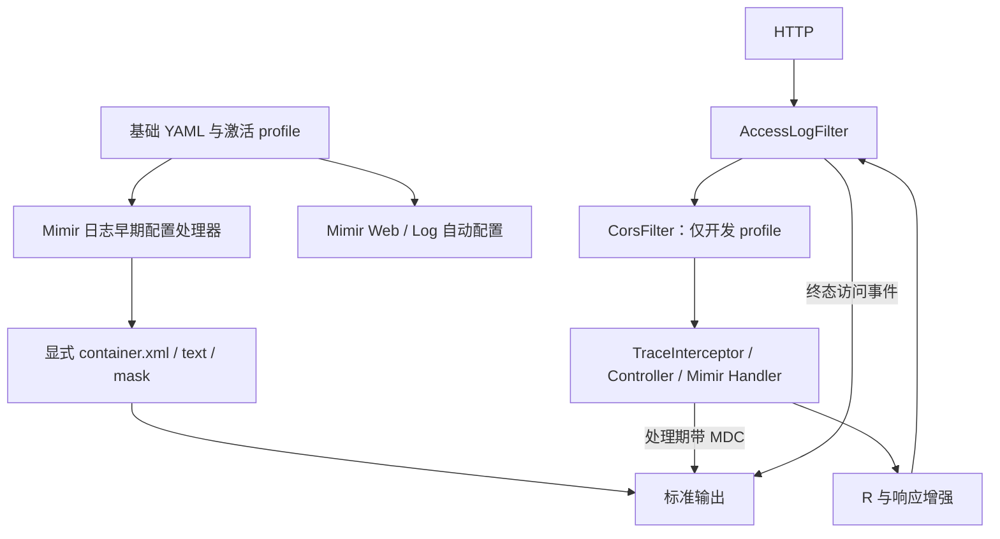

# Mimir 运行时能力接入设计

**归属版本**：1.3.0。基线为 Midgard `5246d96`。关联：[需求约定](spec.md)、[实施计划](plan.md)、[版本记录](../release.md)、TD-014。

## 背景、目标与边界

当前 Start 已依赖 Mimir Log/Web 2.4.0，却保留只输出 `%msg` 的本地 logback-spring.xml、本地 WebMvcConfigurer CORS、四项 COLA 组件及包扫描，并允许 Bean 覆盖。源码已没有 COLA DTO/异常/领域工厂的实际调用；Client 三处 package-info 仍指导继承 COLA 基类。

目标是接入框架原生能力并消除重复配置，明确开发跨域与日志边界。原分层、客户响应/version、审计 Provider、V1/V2 和依赖版本保持现状；不把移除 COLA 组件解释为放弃 COLA 分层理念。本次跨多个模块但主要是装配和配置变更，不新增业务模型或接口。

## 证据与已选取舍

框架依据为相邻 Mimir 仓库 **v2.4.0 tag（3e33c438）**，不依据其当前工作树。下列路径均相对该 tag，省略包前缀部分：

| 来源 | 已核实事实 | 接入决定 |
| --- | --- | --- |
| `mimir-boot-starter-log` 的 `config/LogPresetEnvironmentPostProcessor.java`、`logback/container.xml`、`common.xml` | EPP 识别 logging.config，不替用户选预设；starter 根目录仍有旧 logback-spring.xml | 删除本地 XML 的同时显式选 container.xml，避免落回旧文件日志配置 |
| `common.xml`、`config/LogMaskProperties.java` | 文本预设支持 traceId/spanId、消息及异常脱敏；新预设默认四组凭据规则 | 采用 text，显式四组规则，控制台输出；不新增 encoder 依赖 |
| `web/AccessLogProperties.java`、`AccessLogAutoConfiguration.java`、`AccessLogFilter.java` | 默认开启，logger=access.log；过滤器在同步 chain 返回后打印，记录 URI 而非 query/body | 显式 enabled/3000ms，保留默认排除路径；access.log 单独 INFO |
| `mimir-boot-starter-web` 的 `config/CorsConfig.java`、`WebProperties.java` | allowed-origins 精确匹配；无 allowed-origin-patterns；Filter 固定注册 `/**` | 使用明确白名单并声明路径范围变化，不复制本地 CORS 保留旧通配行为 |
| `config/WebMvcConfig.java`、`interceptor/TraceInterceptor.java` | MVC Trace 拦截器写头及 MDC，afterCompletion 恢复上下文；排除 actuator/swagger 等 | HTTP 头/体及处理期日志关联可测；终态访问日志 traceId 不作保证 |
| Midgard `Application.java`、4 个模块/根 POM、Client package-info | 存在依赖与扫描/说明残留，当前业务代码没有 COLA 引用 | 移除声明和扫描，同步预留 DTO 的说明，不搬迁现有 App DTO |

原版本记录中“Domain 当前仅引用 COLA BizException”是旧阶段描述；当前已使用 mimir-boot-common，本项保留其依赖。现存本地 precheck/ci 记录不证明本次配置已生效。

## 架构与启动路径



应用只扫描 `io.yggdrasil.labs.midgard`；Mimir 继续通过其 AutoConfiguration.imports/spring.factories 接入，不扩大应用扫描到框架包。MapperScan 与现有审计配置保留。配置失败不启用覆盖、不吞异常；缺数据源/迁移失败按现有启动行为失败。

## 配置契约

### 日志及 Bean 策略（B1、B2、B4）

在 `start/src/main/resources/application.yml` 的基础文档合并以下片段；保留现有 exception、serialization、Flyway、application.name 等配置，避免写第二个同名顶层键：

```yaml
spring:
  main:
    allow-bean-definition-overriding: false
logging:
  config: classpath:com/yggdrasil/labs/log/logback/container.xml
  level:
    root: INFO
    io.yggdrasil.labs.midgard: INFO
    access.log: INFO
mimir:
  boot:
    log:
      format: text
      mask:
        enabled-patterns: [password, token, secret, api_key]
        replacement: '****'
      access:
        enabled: true
        slow-threshold-ms: 3000
```

不设置 `exclude-paths`，因此保留正式版默认排除 actuator/favicon/static/public/assets/css/js/images/webjars/error 路径；配置该列表会整体替换默认值，不能误认为追加。container 的 access.log 自带 INFO/additivity=false，基础 YAML 再明确其级别，避免 prod root=WARN 使普通访问日志不可见。SQL.JSON/SQL.SLOW 是该预设自带 logger，但本项不新增 SQL 日志采集或修改其开关。

| 配置层或启动选择 | root | 应用包 `io.yggdrasil.labs.midgard` | access.log |
| --- | --- | --- | --- |
| 基础 YAML 文档值（尚未叠加 profile，不代表默认启动） | INFO | INFO | INFO |
| 未提供外部 profile 选择（默认激活 local） | INFO | DEBUG | INFO |
| local/dev | INFO | DEBUG | INFO |
| test | INFO | INFO | INFO |
| prod | WARN | WARN | INFO |

dev/test/prod 中当前的 `io.yggdrasil.labs.midgard.*` 改为真实包前缀 `io.yggdrasil.labs.midgard`；logging.level 的 logger 名不是 glob。local 的应用 DEBUG 默认随下面激活文档提供，现有 `.example` 继续说明可覆盖级别。输出格式统一为框架带完整日期的文本，旧控制台字符串布局会改变；不承诺旧日志解析器兼容。

### CORS（B3）

在 application.yml 基础文档的现有 `mimir.boot.web` 下合并：

```yaml
cors:
  enabled: false
  allowed-origins: ['http://localhost:5173']
  allowed-methods: [GET, POST, PUT, DELETE, OPTIONS]
  allowed-headers: ['*']
  exposed-headers: [Content-Disposition, X-Trace-Id]
  allow-credentials: true
  max-age: 3600s
```

在同一文件追加一个 profile 文档，作为 local/dev 开关的唯一维护处：

```yaml
---
spring:
  config:
    activate:
      on-profile: '(local | dev) & !test & !prod'
mimir:
  boot:
    web:
      cors:
        enabled: true
logging:
  level:
    io.yggdrasil.labs.midgard: DEBUG
```

保留现有 `spring.profiles.active: local` 的默认启动选择；仅激活 test/prod 时基础 CORS=false，混合 local/dev 与 test/prod 时上述文档不匹配，仍关闭。运行方显式高优先级覆盖是单独配置行为，不宣称框架禁止其覆盖。

默认来源只允许 `http://localhost:5173`，依据 Asgard 当前 VITE_PORT=5173；localhost、127.0.0.1、协议和端口视为不同 Origin。增加其他来源使用原生 `mimir.boot.web.cors.allowed-origins` 完整列表，覆盖而非追加默认列表；不引入额外自定义属性或修改前端。`.example` 给出列表覆盖示例，避免覆盖用户已忽略的 application-local.yml。

删除 Adapter 本地 CorsConfig；新策略由框架 CorsFilter 提供，范围由 `/api/**` 变为 `/**`。开发 Origin 因此也可访问文档/监控路径；prod/test 默认不启用该策略。允许凭据、允许方法、允许请求头、3600s、Content-Disposition 都显式保留，新增 X-Trace-Id 暴露；不增加 X-Request-Id 暴露或 PATCH 方法。启用但空白名单、凭据+`*` 的错误直接使用 Mimir 的启动校验，不添加本地 fallback。

### Trace 与访问记录边界（B1、B2）

客户请求沿用 TraceInterceptor 与 ResponseBodyEnhancer。对于没有已保存 traceId 的新请求，合法头 `runtime-42` 在 HTTP 响应头和 R.traceId 一致。框架的实际优先级为：先复用合法请求属性；不存在合法属性时，若有显式请求头则合法值原样使用、非法值生成新 ID；若无请求头则复用合法 MDC，否则生成新 ID。请求结束恢复原 MDC。记录于拦截器执行期间的应用日志可读取该 MDC；startup、后台线程及被排除路由不作同样承诺，不把无请求头一概等同于新建 ID。

AccessLogFilter 在 chain 返回后的 finally 记录同步请求终态；TraceInterceptor 的 afterCompletion 已恢复 MDC。该 Filter 不从响应头补回 traceId，所以仅使用 Web 拦截器时，终态访问记录可能没有 traceId。外层 observation scope 是否提供标识取决于实际装配；本项不引入追踪依赖、不复制过滤器、不增加 Mimir 补丁，也不把访问日志全链路关联列入通过条件。

访问记录包含 IP、Method、URI、Status、Outcome、ErrorType、Duration、UserAgent。不读取 query/body/Authorization/Cookie，但 URI/UA/IP 本身仍可能含个人信息或任意文本；四组凭据脱敏不是通用数据泄露防护。日志测试使用合成数据；不得为演示脱敏记录真实凭据或新增生产请求体日志。CORS 拒绝/预检早于 MVC，不能要求其有 R/traceId；访问过滤器是否实际包住 CORS 需运行验证。

## 依赖与说明调整（B4）

| 文件 | 删除/调整 | 保留 |
| --- | --- | --- |
| client/pom.xml | cola-component-dto | Client 预留模块及现有独立依赖 |
| domain/pom.xml | cola-component-exception、cola-component-domain-starter | mimir-boot-common、领域代码及其他既有依赖 |
| app/pom.xml | cola-component-catchlog-starter | 应用服务、事务与校验依赖 |
| 根 pom.xml | cola-components-bom 及 cola.components.version | Mimir 2.4.0、revision、质量门禁、其余依赖版本 |
| Start Application | scanBasePackages 去除 com.alibaba.cola | 应用包扫描及 MapperScan |
| Client cmd/qry/co package-info | 去除继承 COLA 基类和相应 callSuper 要求，说明普通契约对象/Serializable | 包职责和命名；不新建 DTO、不迁移 App 对象 |

删除组件可能同时移除传递依赖。实施需用有效依赖树和完整编译定位必要直接依赖，不能因编译失败恢复 COLA 来绕过清理；如需补依赖，仅补当前源码实际使用且由既有 BOM 管理者。未核实的新能力或版本变动须重新对齐。架构文档/README/AGENTS 仅将“基于 COLA 5.0 组件”的歧义改成“遵循 COLA 分层理念”，不改变架构边界，不顺带重写文档治理规则。

## 验证、风险及替代方案

| 对象 | 本地证据 | 真实运行证据 |
| --- | --- | --- |
| B1 日志配置/规则 | 对实际 YAML 合并与绑定做纯单元检查；真实 EPP 对选中 preset/非法规则执行；消息及异常 converter 使用内存事件 | 冷启动选择正确资源，标准输出文本、无本方案文件 appender，合成日志脱敏；各 profile 的实际级别 |
| B2 AccessLogFilter | mock Servlet + 实际 Filter + 内存 appender 验正常/400/500/排除路径，不 sleep 凑慢请求 | HTTP 状态与记录一致，prod 下普通客户访问仍 INFO，一次请求一条访问记录 |
| B3 CORS | 实际配置绑定 WebProperties，直接调用框架 CorsConfig.corsFilter，standalone 测白名单、凭据/方法/暴露头及非法策略 | 框架实际注册及顺序、浏览器可读 X-Trace-Id、prod/test 无开发跨域响应头 |
| B4 清理/启动 | 精确依赖树、应用包扫描、JAR 内容、完整门禁、原有客户测试 | 专用数据库启动，Bean 覆盖关闭且无冲突；真实客户请求及审计/事务不退化 |

纯单元直接构造 Environment、Binder、配置或 Filter 不等于自动装配验证；不使用 ApplicationContextRunner、SpringBootTest、嵌入服务或外部 I/O 测试。源码资源读取属于配置测试输入；日志只进内存，不能让测试误加载旧 XML 创建日志文件。converter 与静态 logger 会影响全局状态，测试须恢复属性、规则、级别、appender 和 MDC，禁止反射访问框架私有测试钩子。

非功能标准：本项目实际依赖树及可执行 JAR 中 COLA 组件数为 0；本地 CORS/XML 重复配置数为 0；不新增磁盘日志 appender；保持现有覆盖率和生产/测试 PMD/CPD 门槛。当前 274 项有效测试的场景须保留，但不机械锁定类名/总数。未设置未经测量的 SLA。

备选 server.xml 会新增文件、滚动与路径运维职责，本项选择 container.xml 保持控制台方式；保留本地 XML 或 CORS 会继续存在双重配置，因此不选。为兼容任意 localhost 端口而扩展 Mimir，不在本项范围；显式白名单更符合已有正式 API。

阶段为依赖/扫描清理 → 日志及 CORS 配置 → 隔离回归/完整门禁 → 专用环境运行验收及记录。未知 Bean 冲突必须定位实际来源，不以重新开启覆盖或排除整项自动配置掩盖。日志配置解析失败阻断启动；日志运行时 stdout 故障沿用框架行为，不承诺审计日志零丢失。未取得专用环境证据时仅报告本地实现与验证，TD-014 保持开放。
